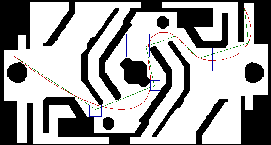

# TDT哨兵导航前后端

这是一个面向二维栅格地图的算法组件，组件提供前端路径搜索、动力学搜索和后端轨迹优化等基础模块，可以根据实际工程需要选择其中的一部分接入。

## 效果展示

https://github.com/user-attachments/assets/041856f4-c33e-4f42-a5ac-2c3a060bfb0f

## 组件内容

- `YAstar`：前端算法，包括普通Astar和Kinodynamic Astar两种搜索算法，支持二维栅格地图的路径规划。
- `MinimumSnapOsqp`：后端算法，可选闭式求解与OSQP求解器求解。

## 目录结构

```text
.
├── src/                            # 组件源码
│   ├── YAstar/                     # 前端算法
│   |   ├── yastar.hpp              # 普通astar算法
│   |   ├── yastar.cpp              # 普通astar算法
|   |   ├── kinodynamicAstar.hpp    # kastar算法
│   |   └── kinodynamicAstar.cpp    # kastar算法
│   └── MinimumSnapOsqp/            # 后端算法
│        ├── minimumSnap.hpp        # Minimum Snap轨迹优化
│        ├── minimumSnap.cpp        # Minimum Snap轨迹优化
|        ├── sfcSquare.hpp          # 方形约束生成
|        └── sfcSquare.cpp          # 方形约束生成
├── 3rd/                            # OSQP 与 OsqpEigen 子模块
├── doc/                            # 算法说明
├── images/                         # 示例地图和文档图片
├── scripts/setup.sh                # 环境配置脚本
├── main.cpp                        # 使用示例
└── CMakeLists.txt                  # 示例构建配置
```

## 环境配置

当前构建需要支持 C++17 的编译器、CMake 3.8 及以上、Eigen3、OSQP 和 OsqpEigen。
依赖部署脚本仍有交接文档记录的子模块缺失问题；已有 `/usr/local` 安装可直接供 CMake 查找，
不要假定下面的脚本能够在全新环境完成安装：

```bash
./scripts/setup.sh
```

脚本会将 OSQP 和 OsqpEigen 构建并安装到 `3rd/install`。OpenCV只用于 `main.cpp` 示例中的图片读取和可视化，不属于算法组件的核心依赖，需要运行示例时再自行安装。

如果需要安装在环境内，可以选择以下命令行：
```bash
# 安装osqp
git clone --recursive -b v1.0.0 https://github.com/osqp/osqp
cd osqp
mkdir build
cd build
cmake .. -DBUILD_SHARED_LIBS=ON
make -j8
sudo make install

# osqp-eigen安装
git clone -b v0.11.0 https://github.com/robotology/osqp-eigen.git
cd osqp-eigen
mkdir build 
cd build
cmake ..    # 默认安装在/usr/local/include中,非apt安装的包，不在/usr/include/下，而是/usr/local/include下
make -j8
sudo make install
```

## 使用示例

`main.cpp`只是一个使用示例，实际工程可以根据需要引入 `src` 中的组件源码。
运行 `main.cpp` 示例：

```bash
mkdir build
cd build
cmake ..
make -j4
./play
```

运行结果：


其中：
- 绿色折线为前端搜索后化简的路径。
- 蓝色框为后端优化最终使用的走廊。
- 红色曲线为后端优化的最终轨迹。

### 运行参数
| key | value | description |
| --- | --- | --- |
| 分辨率 | 0.05m | 栅格分辨率，场地宽高为560x300 |
| 掩码层数 | 4 | 掩码层数，用于管理障碍物 |
| 势场函数 | $$ f(x) = \frac{0.5}{0.1 + x} + 1.0 $$ | x为距离障碍物距离 |
| DP路径化简停止阈值 | 0.1m | 与直线化简共同使用 |
| 多项式参数数量 | 6 | 0~5阶多项式，6个参数 |
| 导数阶数 | 3 | 3阶平滑，即minimum jerk |
| 采样时间 | 0.1s | MinimumSnap结果函数按照分配时间、速度进行采样，得到曲线 |
| 迭代次数 | 6 | 迭代次数 |
| 机器人最大速度 | 3.0m/s | 用于分配时间、约束速度 |
| 机器人最大加速度 | 1.0m/s^2 | 用于分配时间 |
| sfc膨胀最大范围 | 2.5m | 方形走廊区域膨胀范围 |
| sfc缩小范围 | 自动 | 每次收缩为原始的一半 |
| 归一化时间 | 开启 | MinimumSnap使用归一化时间，提高长距离数值稳定性 |
| 求解后端 | OSQPCorridor | 带sfc的OSQP求解后端 |
| 初速度 | 0.0m/s | 初速度默认值是不限制 |
| 最终速度 | 0.0m/s | 最终速度默认值为0.0 |

### 性能表现

测试环境：
- AMD 7735H @ 4.2GHz
- Ubuntu 22.04
- GCC 11.2.0

在RMUC2024地图上，使用以上运行参数测试1000次搜索的性能表现如下：

| 算法 | 平均时间 | 最大时间 |
| --- | --- | --- |
| Astar | 7627.44 us | 21806 us |
| Minimum Snap | 1255.42 us | 14493.1 us |
| 生成代价地图 | 1604.13 us | 6870.61 us |
| 化简路径 | 34.0191 us | 242.632 us |

在RMUC2026地图上，使用以上运行参数测试1000次搜索的性能表现如下：

| 算法 | 平均时间 | 最大时间 |
| --- | --- | --- |
| Astar | 5446.45 us | 14761.2 us |
| Minimum Snap | 3901.7 us | 126698 us |
| 生成代价地图 | 1588.52 us | 3613.08 us |
| 化简路径 | 26.0119 us | 117.99 us |

## 自动测试与历史复现

```bash
python3 scripts/run_benchmark.py
python3 scripts/run_benchmark.py --map images/inside_map.png --resolution 0.05 --count 100
```

C++ 执行算法并计时，Python 保存日志和汇总报告。每次运行自动保存时间种子、地图和输入，
支持手动重跑任意历史样例或查看当次轨迹。原来的 `cd build && ./play` 保留手动演示。

- [简明使用指南](doc/BenchmarkUsage.md)
- [本次变更说明](doc/BenchmarkChanges.md)

## 文档

- [`doc/Astar.md`](doc/Astar.md)：Astar 和 Kinodynamic Astar 的原理与规划思路。
- [`doc/MinimumSnap.md`](doc/MinimumSnap.md)：Minimum Snap 的数学建模、求解和碰撞处理。
- [`doc/Usage.md`](doc/Usage.md)：使用文档。

## 联系作者
1. SnifferCaptain
    - qq: 3586554865
    - email: 3586554865@qq.com
    - github: https://github.com/SnifferCaptain
2. Nathongc
    - qq: 738607264
    - github: https://github.com/Nathongc

## Third-party

| project | description | license |
| --- | --- | --- |
| [OSQP](https://github.com/osqp/osqp) | 二次规划求解器 | [Apache-2.0](https://github.com/osqp/osqp/blob/master/LICENSE) |
| [OsqpEigen](https://github.com/robotology/osqp-eigen) | OSQP 的 Eigen C++ 封装 | [BSD-3-Clause](https://github.com/robotology/osqp-eigen/blob/master/LICENSE) |
| [Eigen](https://gitlab.com/libeigen/eigen) | A C++ template library for linear algebra | [Mozilla Public License Version 2.0](https://gitlab.com/libeigen/eigen/-/blob/master/LICENSE) |

Eigen3 和 OpenCV 是外部依赖，许可证请以各自安装版本附带的许可证为准。

## License

使用 [MIT](LICENSE) 许可证，SnifferCaptain and Nathongc
